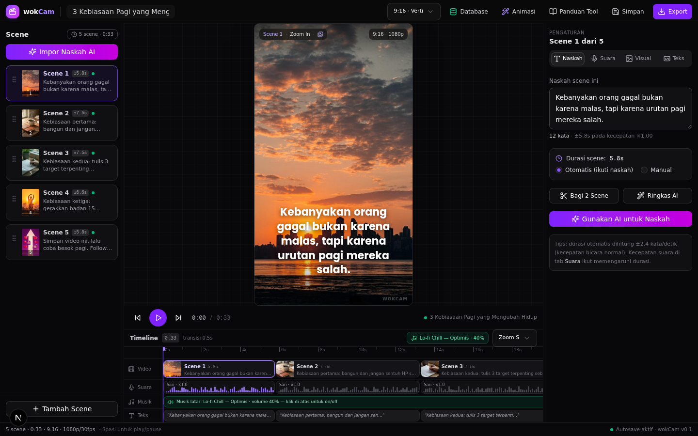
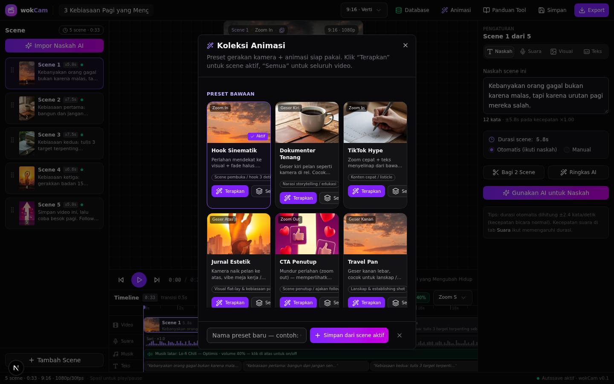
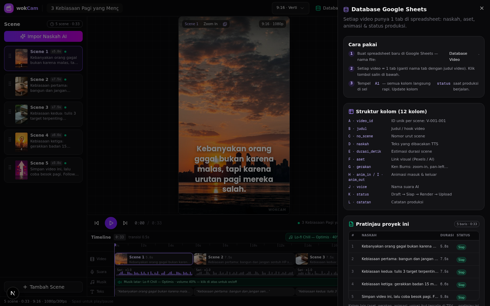
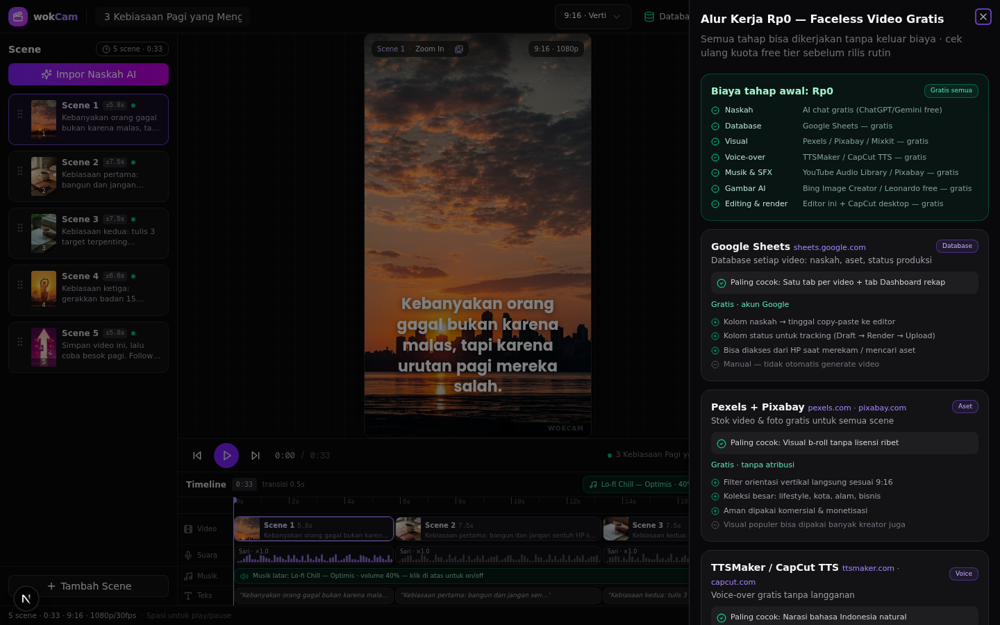

<div align="center">

# 🎬 wokCam

**Studio produksi video faceless dengan biaya Rp0 — dibangun dengan Next.js 16**


*Editor timeline bergaya CapCut/Premiere · Database Google Sheets per video · Koleksi animasi preset · 18 sumber aset gratis*

</div>

---

## 📖 Bahasa Indonesia

**wokCam** adalah studio produksi video faceless (video tanpa wajah) yang seluruh alur kerjanya bisa dijalankan **tanpa biaya sama sekali (Rp0)**. Proyek ini terdiri dari dua bagian:

1. **Editor web (repo ini)** — aplikasi Next.js berisi editor timeline lengkap: daftar scene, pratinjau langsung, timeline 4 track, inspector, subtitle karaoke, koleksi animasi preset, panel database Google Sheets, dan direktori sumber aset gratis.
2. **Alur kerja & dokumentasi** — panduan lengkap memproduksi video faceless menggunakan AI chat untuk naskah, Google Sheets sebagai database per video, aset gratis (Pexels, Pixabay, TTSMaker, CapCut), dan editor ini sebagai "blueprint" visual.

> 💡 Saat ini editor masih berupa **mockup UI fungsional** (pratinjau simulasi, belum merender MP4). Lihat [docs/11-roadmap.md](docs/11-roadmap.md) untuk rencana integrasi TTS API + render FFmpeg/Remotion.

### ✨ Fitur

| Fitur | Penjelasan | Dokumen |
|---|---|---|
| 🎞️ Editor timeline | Daftar scene, pratinjau 9:16/1:1/16:9, timeline 4 track (video, suara, musik, teks) | [07-editor-ui.md](docs/07-editor-ui.md) |
| 🤖 Impor Naskah AI | Tempel naskah dari ChatGPT/Gemini → otomatis terpotong jadi scene (maks. 22 kata/scene) | [07-editor-ui.md](docs/07-editor-ui.md) |
| 🎥 Gerakan Ken Burns | Zoom in/out, pan 6 arah, statis — dihitung real-time per scene | [08-arsitektur-teknis.md](docs/08-arsitektur-teknis.md) |
| ✨ Koleksi Animasi | 8 preset animasi siap pakai + simpan preset buatan sendiri | [05-koleksi-animasi.md](docs/05-koleksi-animasi.md) |
| 🗄️ Database Google Sheets | 12 kolom per video, ekspor TSV siap tempel di sel A1 + unduh CSV | [03-database-google-sheets.md](docs/03-database-google-sheets.md) |
| 🎁 Sumber Aset Gratis | 18 situs terverifikasi di 7 kategori (video, foto, musik, SFX, TTS, gambar AI, font) | [04-aset-gratis.md](docs/04-aset-gratis.md) |
| 🗣️ Voice-over | 6 karakter suara AI Indonesia + estimasi durasi otomatis (2,4 kata/detik) | [06-voice-over-tts.md](docs/06-voice-over-tts.md) |
| 💬 Subtitle | 5 preset (Karaoke Neon, TikTok Tebal, Kotak Sorot, Bersih, Tanpa Teks) + 3 font | [07-editor-ui.md](docs/07-editor-ui.md) |
| 💰 Panduan Rp0 | Tabel biaya per tahap + perbandingan tool gratis vs SaaS berbayar | [02-alur-kerja-rp0.md](docs/02-alur-kerja-rp0.md) · [09-panduan-tool.md](docs/09-panduan-tool.md) |

### 🖼️ Tampilan

| Editor utama | Koleksi Animasi |
|---|---|
|  |  |

| Database Google Sheets | Panduan Rp0 |
|---|---|
|  |  |

<div align="center"><sub>Modal Export & tampilan mobile 390px ada di <a href="docs/img">docs/img/</a></sub></div>

### 🚀 Mulai Cepat

```bash
# 1. Clone / unduh repo
git clone https://github.com/USERNAME/wokCam.git
cd wokCam

# 2. Install dependensi (pilih salah satu)
bun install        # direkomendasikan
npm install        # atau npm / pnpm

# 3. Jalankan server pengembangan
bun run dev        # → http://localhost:3000

# 4. Build produksi (opsional)
bun run build && bun run start
```

> Syarat: Node.js ≥ 20 atau Bun ≥ 1.1. Tidak butuh API key, tidak butuh database — seluruh state disimpan di memori + `localStorage`.

### 🗂️ Struktur Repo

```
wokCam/
├── src/
│   ├── app/                    # Halaman Next.js (App Router)
│   ├── components/editor/      # 9 komponen editor + 4 tab inspector
│   ├── components/ui/          # Komponen shadcn/ui
│   └── lib/editor/             # Inti logika: model.ts · engine.ts · store.ts
├── public/scenes/              # 5 gambar scene contoh (vertikal 9:16)
├── docs/                       # 📚 11 dokumen panduan (bahasa Indonesia)
│   └── img/                    # Screenshot editor
├── templates/                  # 📋 Template: CSV database, prompt AI, checklist
├── README.md
├── CONTRIBUTING.md
├── CHANGELOG.md
└── LICENSE
```

### 🧭 Peta Dokumen

| # | Dokumen | Isi |
|---|---|---|
| 01 | [Ikhtisar](docs/01-ikhtisar.md) | Visi, masalah yang dipecahkan, komponen wokCam |
| 02 | [Alur Kerja Rp0](docs/02-alur-kerja-rp0.md) | 6 langkah produksi video tanpa biaya, tabel biaya per tahap |
| 03 | [Database Google Sheets](docs/03-database-google-sheets.md) | Struktur 12 kolom, cara impor/ekspor, dashboard status |
| 04 | [Sumber Aset Gratis](docs/04-aset-gratis.md) | 18 situs + lisensi + tips pemakaian |
| 05 | [Koleksi Animasi](docs/05-koleksi-animasi.md) | 8 preset bawaan + preset buatan sendiri |
| 06 | [Voice-over & TTS](docs/06-voice-over-tts.md) | 6 suara AI, rumus durasi, TTS gratis Indonesia |
| 07 | [Panduan Editor UI](docs/07-editor-ui.md) | Tur lengkap semua panel & alur pengeditan |
| 08 | [Arsitektur Teknis](docs/08-arsitektur-teknis.md) | model/store/engine, implementasi Ken Burns & karaoke |
| 09 | [Panduan Tool](docs/09-panduan-tool.md) | Stack gratis vs SaaS berbayar (InVideo, Fliki, Pictory) |
| 10 | [Strategi Konten](docs/10-strategi-konten.md) | Hook, struktur video, kalender, metrik |
| 11 | [Roadmap](docs/11-roadmap.md) | Fase 1–3: mockup → TTS nyata + render MP4 → otomasi |

### 🤝 Kontribusi

Baca [CONTRIBUTING.md](CONTRIBUTING.md) — setup dev, konvensi commit, dan area yang butuh bantuan (terutama integrasi TTS API dan render FFmpeg).

### 📄 Lisensi

[MIT](LICENSE) — bebas dipakai, dimodifikasi, dan di-distribusikan.

---

## 🌍 English

**wokCam** is a faceless-video production studio whose entire workflow can be run at **zero cost**. It combines a Next.js timeline editor (scene list, live preview, 4-track timeline, karaoke subtitles, animation presets, a Google Sheets database panel, and a free-asset directory) with a complete Indonesian-language playbook: AI chat for scripts, Google Sheets as the per-video database, and free asset sources (Pexels, Pixabay, TTSMaker, CapCut).

> 💡 The editor is currently a **functional UI mockup** (simulated preview, no MP4 rendering yet). See [docs/11-roadmap.md](docs/11-roadmap.md) for the real TTS API + FFmpeg/Remotion render plan.

**Quick start**

```bash
git clone https://github.com/USERNAME/wokCam.git && cd wokCam
bun install     # or npm install
bun run dev     # → http://localhost:3000
```

**Requirements:** Node.js ≥ 20 or Bun ≥ 1.1. No API keys, no database needed — state lives in memory + `localStorage`.

**Key features:** Ken Burns motion engine · 8 built-in animation presets + user presets (localStorage) · script import that auto-splits into scenes (~22 words each) · 6 Indonesian AI voices with automatic duration estimation (2.4 words/sec) · 5 subtitle presets · 12-column Google Sheets schema with one-click TSV/CSV export · 18 verified free asset sources across 7 categories · full Rp0 (zero-budget) workflow guide.

**Docs are written in Indonesian** — start at [docs/01-ikhtisar.md](docs/01-ikhtisar.md) or skim the table above. The editor UI language is Indonesian by design.

**License:** [MIT](LICENSE). Contributions welcome — see [CONTRIBUTING.md](CONTRIBUTING.md).
