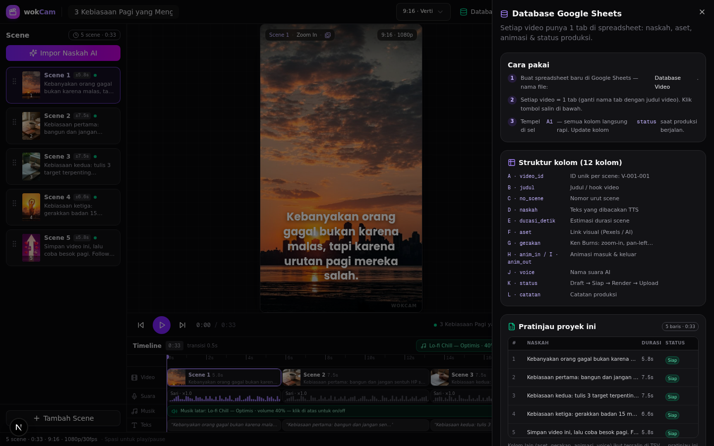

# 03 · Database Google Sheets — Struktur 12 Kolom

> Peta dokumen: [02 Alur Kerja Rp0](02-alur-kerja-rp0.md) ← | → [04 Sumber Aset Gratis](04-aset-gratis.md)

Setiap video wajib punya **satu tab di Google Sheets**. Aturan ini bukan formalitas: kolom `status` dan `catatan` adalah memori channel — saat satu video viral, kamu tahu persis naskah, aset, dan gerakan mana yang dipakai.

Panel **Database** di editor (tombol 🗄️ **Database** di TopBar) menampilkan struktur ini secara hidup dari scene yang sedang diedit, lengkap dengan tombol ekspor.



## 1. Struktur kolom (A–L)

Struktur ini didefinisikan di `src/lib/editor/model.ts` (`SHEET_COLUMNS`) dan dipakai identik oleh fungsi ekspor di `src/lib/editor/engine.ts` (`buildSheetTsv`):

| Kolom | Key | Isi | Contoh |
|---|---|---|---|
| A | `video_id` | ID unik video, format `slug-nomor` | `3-kebiasaan-pagi-001` |
| B | `judul` | Judul / hook video | `3 Kebiasaan Pagi yang Mengubah Hidup` |
| C | `no_scene` | Nomor urut scene | `1` |
| D | `naskah` | Teks yang dibacakan TTS (1 baris = 1 scene) | `Kebanyakan orang gagal bukan karena malas…` |
| E | `durasi_detik` | Estimasi durasi scene (detik, 1 desimal) | `5.8` |
| F | `aset` | Sumber visual: URL Pexels/Unsplash atau label AI/upload | `pexels.com/photo/12345` |
| G | `gerakan` | Ken Burns: `zoom-in`, `zoom-out`, `pan-left`, `pan-right`, `pan-up`, `pan-down`, `static` | `zoom-in` |
| H | `anim_in` | Animasi masuk: `fade`, `slide-up`, `slide-down`, `zoom`, `none` | `fade` |
| I | `anim_out` | Animasi keluar: `fade`, `slide-down`, `zoom`, `none` | `fade` |
| J | `voice` | Nama suara AI yang dipakai | `Sari` |
| K | `status` | `Draft` / `Siap` / `Render` / `Upload` | `Siap` |
| L | `catatan` | Catatan produksi bebas | `Ganti visual klip 3, hook kurang tajam` |

**Catatan format `video_id`:** editor membuatnya otomatis dari nama proyek — slug huruf kecil maksimal 40 karakter + nomor scene 3 digit (mis. `3-kebiasaan-pagi-001`). Satu video punya 5–10 baris dengan `video_id` berbeda hanya di nomor akhir.

## 2. Cara mengisi: dua jalur

### Jalur A — Tempel dari editor (dianjurkan)
1. Selesaikan pengeditan di wokCam.
2. Buka panel **Database** → tombol **Salin untuk Sheets**.
3. Data yang disalin berformat **TSV** (tab-separated): header 12 kolom + 1 baris per scene.
4. Di tab video di Google Sheets, klik sel **A1** → `Ctrl+V`. Tab otomatis menyebar menjadi kolom.
5. Kolom D–K langsung terisi: naskah, durasi, aset, gerakan, animasi, voice, status (`Siap`/`Draft`).

### Jalur B — Unduh CSV
Tombol **Unduh CSV** menghasilkan file `slug-video.csv` (dengan BOM UTF-8 agar terbaca benar di Excel/Sheets) → import via *File → Import → Upload* atau drag ke Sheets. Pakai jalur ini kalau ingin arsipkan file per video.

### Template siap pakai
- [`templates/database-video.csv`](../templates/database-video.csv) — header + 5 baris contoh dari video demo "3 Kebiasaan Pagi". Buat salinan, ganti isinya.
- Kolom tambahan (mis. `tanggal_upload`, `views_24h`, `link_tiktok`) boleh ditambahkan di kolom M+ — editor hanya menulis A–L.

## 3. Pratinjau live di panel

Panel Database menampilkan tabel ringkas: nomor scene, potongan naskah, durasi, dan status dengan badge warna — **Siap** (hijau) / **Draft** (kuning) — supaya kekurangan terlihat sebelum ekspor.


## 4. Tab Dashboard (opsional tapi disarankan)

Buat satu tab `Dashboard` di file yang sama untuk rekap lintas video:

```excel
=QUERY('3-kebiasaan-pagi'!A1:L50, "select K, count(C) where K is not null group by K", 1)
```

atau untuk melacak status semua video sekaligus dengan `IMPORTRANGE`:

```excel
=IMPORTRANGE("URL_SPREADSHEET", "Dashboard!A1:D20")
```

Rekap minimal yang berguna:
- jumlah video per status (`Draft`/`Siap`/`Render`/`Upload`),
- total durasi naskah per video (`SUM` kolom E, dibagi 60 = menit),
- tanggal upload + performa 24 jam pertama (kolom M+).

## 5. Validasi data (opsional)

Supaya tidak typo saat mengedit manual:
1. Blok kolom **G** (`gerakan`) → *Data → Data validation* → Dropdown dari daftar: `zoom-in, zoom-out, pan-left, pan-right, pan-up, pan-down, static`.
2. Blok kolom **H/I** → dropdown: `fade, slide-up, slide-down, zoom, none`.
3. Blok kolom **K** → dropdown: `Draft, Siap, Render, Upload`.
4. Kolom **E** → *Data → Number between 1 and 60* (batas yang sama dengan `durationOverride` di kode).

Nilai di kolom G–I persis sama dengan nilai tipe di `src/lib/editor/model.ts` — jadi blueprint di editor dan baris database tidak akan pernah beda bahasa.

## 6. Praktik baik

- **Jangan hapus baris** video lama — Sheets murah, data historis mahal.
- **Satu file Spreadsheet per channel** (bukan per video) agar dashboard rekap jalan.
- **Tempel URL aset di kolom F** meski aset sudah diunduh — kalau file lokal hilang, sumbernya masih bisa diambil ulang.
- **Isi `catatan` saat kejadian** (mis. "hook scene 1 diubah jadi pertanyaan") — bukan setelah upload.
