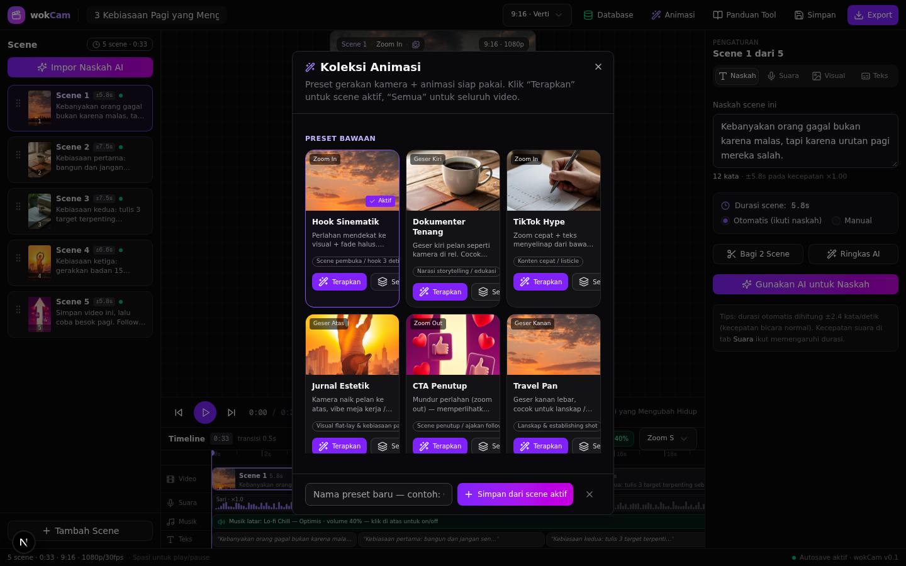

# 05 · Koleksi Animasi — Preset Gerakan Siap Pakai

> Peta dokumen: [04 Sumber Aset Gratis](04-aset-gratis.md) ← | → [06 Voice-over & TTS](06-voice-over-tts.md)

**Koleksi Animasi** adalah dialog khusus di editor wokCam (tombol ✨ **Animasi** di TopBar, juga bisa dibuka dari tab **Visual** di Inspector). Tujuannya satu: **konsistensi gerakan antar scene** tanpa harus mengatur zoom/pan satu per satu.



## 1. Apa isi satu preset?

Satu preset animasi = kombinasi 4 properti yang tersimpan per scene:

| Properti | Pilihan yang tersedia |
|---|---|
| `motion` (gerakan kamera) | `zoom-in`, `zoom-out`, `pan-left`, `pan-right`, `pan-up`, `pan-down`, `static` |
| `animIn` (animasi masuk) | `fade`, `slide-up`, `slide-down`, `zoom`, `none` |
| `animOut` (animasi keluar) | `fade`, `slide-down`, `zoom`, `none` |
| `loop` (gerakan berulang) | `true` = gerak-mundur-gerak halus selama scene; `false` = gerakan sekali lalu diam |

## 2. Delapan preset bawaan

Definisi resmi ada di `src/lib/editor/model.ts` (`ANIMATION_PRESETS`). Kartu preset di aplikasi menampilkan **pratinjau bergerak langsung** (animasi CSS yang mencerminkan gerakan aslinya):

| Preset | Motion | In | Out | Loop | Cocok untuk |
|---|---|---|---|---|---|
| **Hook Sinematik** | zoom-in | fade | fade | ✅ | Scene pembuka / hook 3 detik pertama |
| **Dokumenter Tenang** | pan-left | fade | fade | ✅ | Narasi storytelling / edukasi kalem |
| **TikTok Hype** | zoom-in | slide-up | zoom | ✅ | Konten cepat / listicle, energi tinggi |
| **Jurnal Estetik** | pan-up | slide-up | fade | ✅ | Flat-lay, meja kerja, morning routine |
| **CTA Penutup** | zoom-out | zoom | fade | ✅ | Scene penutup / ajakan follow |
| **Travel Pan** | pan-right | fade | fade | ✅ | Lanskap & establishing shot |
| **Dolly Reveal** | zoom-in | zoom | zoom | ❌ | Reveal produk / momen dramatis |
| **Poster Statis** | static | fade | fade | ❌ | Quote, teks besar, data/infografis |

### Pola kombinasi yang terbukti enak ditonton

```
Scene 1 (hook)    → Hook Sinematik   (penonton fokus ke tengah)
Scene 2..N (isi)  → Dokumenter Tenang ATAU TikTok Hype (satu saja, jangan campur)
Scene terakhir    → CTA Penutup      (mundur perlahan, ajakan muncul)
```

Aturan praktis: **satu video maksimal 2–3 preset**. Terlalu banyak variasi = terasa seperti slideshow acak.

## 3. Cara pakai di aplikasi

1. Klik **✨ Animasi** di TopBar (atau tombol **Koleksi Animasi** di tab Visual).
2. Pilih scene tujuan di daftar scene kiri (atau biarkan scene aktif).
3. Di kartu preset → **Terapkan** (untuk 1 scene) atau **Semua** (seluruh video).
4. Scene yang cocok dengan preset tertentu ditandai ✓ **Aktif** pada kartunya.

## 4. Preset buatan sendiri

Kombinasi gerakan favoritmu bisa dijadikan preset permanen:

1. Atur scene sampai gerakannya pas (di tab Visual atau langsung dari kartu preset).
2. Buka Koleksi Animasi → bagian **Preset buatan sendiri** → ketik nama (maks. 28 karakter) → **Simpan dari scene aktif**.
3. Preset baru muncul paling atas dengan badge **Buatanmu** — bisa diterapkan, dan dihapus dengan tombol ✕.

**Penyimpanan:** preset custom disimpan di `localStorage` browser dengan key `wokcam-presets` (array JSON berisi objek `AnimationPreset` dengan flag `custom: true`). Implementasi: `loadCustomPresets()` / `persistCustomPresets()` di `src/lib/editor/store.ts`.

> ⚠️ Karena tersimpan per-browser: ganti browser/perangkat = preset custom tidak ikut. Kalau ingin pindah, ekspor manual nilai `localStorage` tersebut. Integrasi sinkron ke Google Sheets masuk [roadmap Fase 3](11-roadmap.md).

## 5. Jika ingin menambah preset bawaan

Tambahkan satu objek ke array `ANIMATION_PRESETS` di `src/lib/editor/model.ts`:

```ts
{
  id: 'p-konferensi',
  name: 'Konferensi Tenang',
  desc: 'Geser bawah pelan, cocok untuk visual vertikal gedung/skyline.',
  bestFor: 'Konten berita / facts',
  motion: 'pan-down',
  animIn: 'fade',
  animOut: 'fade',
  loop: true,
},
```

ID harus unik dan berawalan `p-` (preset custom otomatis berawalan `c-`). Tidak ada langkah lain — kartu, pratinjau bergerak, dan pencocokan status "Aktif" membaca dari array yang sama.

## 6. Contoh nyata dari video demo

Video demo bawaan repo ("3 Kebiasaan Pagi yang Mengubah Hidup") memakai pola:

| Scene | Naskah singkat | Gerakan | In |
|---|---|---|---|
| 1 · Hook | "Kebanyakan orang gagal…" | zoom-in | fade |
| 2 · Kebiasaan 1 | "Jangan sentuh HP 10 menit…" | pan-right | slide-up |
| 3 · Kebiasaan 2 | "Tulis 3 target terpenting…" | zoom-in | fade |
| 4 · Kebiasaan 3 | "Gerakkan badan 15 menit…" | pan-left | slide-up |
| 5 · CTA | "Simpan video ini… Follow" | zoom-out | zoom |
