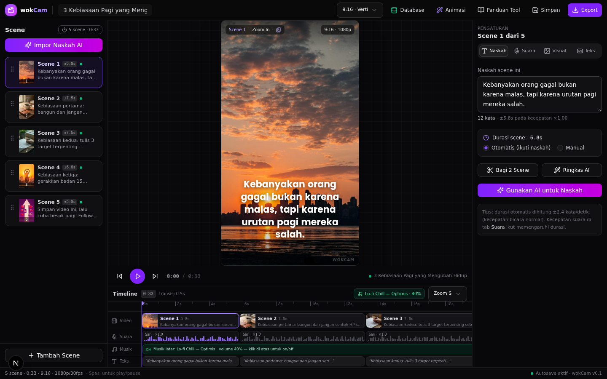
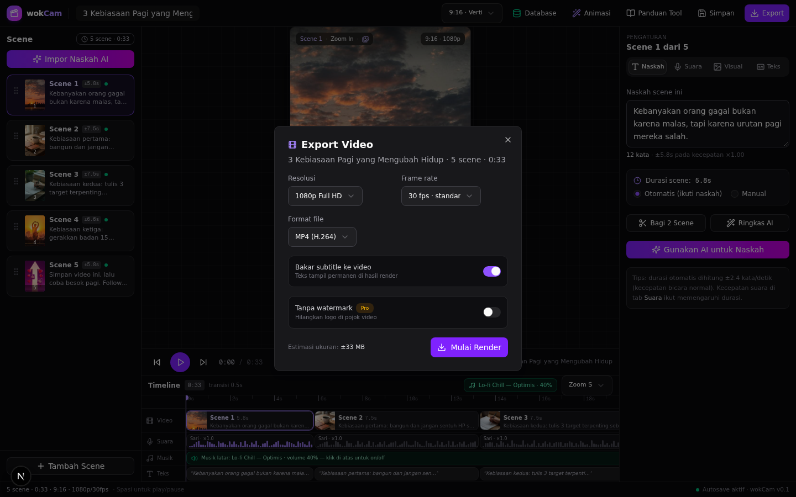
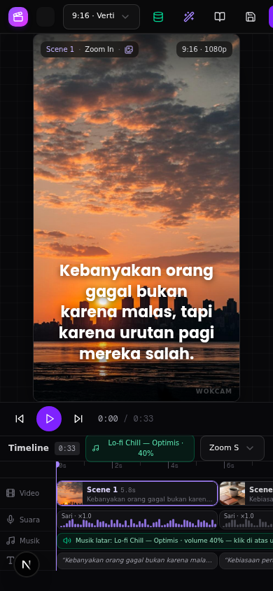

# 07 · Panduan Editor UI

> Peta dokumen: [06 Voice-over & TTS](06-voice-over-tts.md) ← | → [08 Arsitektur Teknis](08-arsitektur-teknis.md)

Editor wokCam meniru layout studio video profesional (CapCut/Premiere) dengan tema gelap + aksen violet. Layar terbagi 4 zona + 4 dialog.



```
┌──────────────────────────────────────────────────────────────┐
│ TopBar: brand · nama proyek · rasio · Database·Animasi·…     │
├────────────┬─────────────────────────────┬───────────────────┤
│ SceneList  │ PreviewCanvas (pratinjau)   │ Inspector         │
│ (kiri)     │ + kontrol playback          │ (kanan, 4 tab)    │
│            ├─────────────────────────────┤                   │
│            │ Timeline (4 track)          │                   │
├────────────┴─────────────────────────────┴───────────────────┤
│ StatusBar: jumlah scene · durasi total · rasio · autosave    │
└──────────────────────────────────────────────────────────────┘
```

## 1. TopBar

| Elemen | Fungsi |
|---|---|
| **Nama proyek** (input) | Menjadi judul video di ekspor TSV/CSV dan dasar `video_id` (slug) |
| **Rasio aspek** | `9:16 · Vertikal` (default), `1:1 · Persegi`, `16:9 · Lanskap` — pratinjau langsung menyesuaikan |
| 🗄️ **Database** | Membuka panel Google Sheets (ekspor TSV/CSV) — [dokumen 03](03-database-google-sheets.md) |
| ✨ **Animasi** | Membuka Koleksi Animasi — [dokumen 05](05-koleksi-animasi.md) |
| 📖 **Panduan Tool** | Alur Rp0 + tabel biaya + stack gratis |
| 💾 **Simpan** | Penanda (demo) — state sudah live di memori |
| ⬇️ **Export** | Modal ekspor (simulasi render) |

## 2. SceneList (panel kiri)

- **Impor Naskah AI** — tempel naskah panjang; otomatis dipecah per kalimat, digroup maks. 22 kata/scene, menggantikan seluruh scene. Titik awal ideal saat mulai video baru.
- **Kartu scene** — nomor, thumbnail, potongan naskah, badge durasi (±5.8s), titik hijau = status *ready*. Klik untuk memilih + melompat ke waktu scene.
- **Tombol drag** di tepi kartu untuk mengubah urutan (reorder).
- **＋ Tambah Scene** — menambah scene kosong setelah scene terpilih.

Klik kanan pada scene juga menyediakan menu: duplikat, bagi 2 scene, hapus.

## 3. PreviewCanvas (pratinjau)

- Merender scene aktif dengan **gerakan Ken Burns real-time** (CSS transform + `requestAnimationFrame`).
- Overlay kiri-atas: `Scene N · gerakan · ikon sumber aset`; kanan-atas: `rasio · 1080p`; kanan-bawah: watermark **wokCam**.
- **Subtitle** dirender sesuai preset teks — kata aktif disorot pada mode karaoke.
- Kontrol: ⏮ ulang, ▶/⏸ putar (juga tombol **Spasi**), ⏭ ke scene berikutnya, waktu `0:00 / 0:33`.
- Badge kanan bawah: nama proyek aktif.

## 4. Timeline (bawah pratinjau)

4 track, semua bisa diklik untuk seek:

| Track | Isi |
|---|---|
| **Video** | Blok per scene dengan thumbnail + potongan naskah; lebar = durasi |
| **Suara** | Waveform per scene + label voice (`Sari · ×1.0`); simulasi deterministik |
| **Musik** | Satu blok musik latar (default *Lo-fi Chill — Optimis · 40%*); klik untuk on/off |
| **Teks** | Strip subtitle per scene |

Pengaturan: **transisi** (crossfade 0,1–1,5 s, default 0,5 s) dan **zoom** timeline (px/detik, 3 tingkat). Garis playhead bergeser saat playback; ruler menandai tiap 2 detik.

## 5. Inspector (panel kanan, 4 tab)

### Tab 📝 Naskah
- Textarea naskah scene (mengubah durasi otomatis bila opsi *Otomatis*).
- Info: `12 kata · ±5.8s pada kecepatan ×1.00`.
- **Durasi scene:** Otomatis (mengikuti naskah) / Manual (input detik).
- **Bagi 2 Scene** — memotong scene jadi dua, berdasarkan kalimat.
- **Ringkas AI** — memangkas naskah jadi ±setengah kalimat pertama.
- **Gunakan AI untuk Naskah** (tombol gradient) — placeholder alur ke AI chat; saat ini menampilkan panduan prompt.

### Tab 🎙️ Suara
6 kartu voice + slider kecepatan (×0.5–×2.0), pitch (−5–+5), volume (0–100) — rincian di [dokumen 06](06-voice-over-tts.md).

### Tab 🖼️ Visual
- **Gerakan kamera** (7 pilihan) + tombol **Koleksi Animasi**.
- **Animasi masuk / keluar** (fade, slide, zoom, none).
- **Loop gerakan** on/off.
- **Aset scene**: pilih dari 8 stok bawaan (5 dengan gambar), sumber AI, atau upload — dengan label sumber.
- **Sumber Aset Gratis (Rp0)** — collapsible emerald berisi 18 situs terfilter per kategori — [dokumen 04](04-aset-gratis.md).

### Tab 💬 Teks
- **Subtitle on/off** + 5 preset: *Karaoke Neon* (kata aktif disorot warna), *TikTok Tebal* (kapital, outline hitam), *Kotak Sorot* (frase dalam kotak warna), *Bersih* (putih elegan), *Tanpa Teks*.
- **Font**: Poppins / Montserrat / Geist · **Ukuran** · **Posisi**: atas/tengah/bawah.
- **Sorot kata aktif** + pilih 5 warna aksen (kuning, emerald, violet, pink, putih).

## 6. Dialog Export



- Ringkasan: jumlah scene, durasi total, rasio, voice, preset subtitle.
- **Salin Naskah TTS** — seluruh naskah polos untuk ditempel ke TTSMaker/CapCut.
- **Salin untuk Sheets** — TSV 12 kolom (lihat [dokumen 03](03-database-google-sheets.md)).
- **Simulasi render** — progress bar dengan tahap (gabung scene → tulis subtitle → mix audio → encode) sebagai bentuk alur yang akan dipakai mesin render nyata.

## 7. Dialog Panduan Tool

Alur Rp0 lengkap: tabel biaya Rp0 per tahap, 4 kartu stack gratis (Sheets, Pexels+Pixabay, TTSMaker/CapCut TTS, CapCut Desktop) dengan plus/minus, 6 langkah kerja, opsi SaaS berbayar untuk nanti — dipandu di [dokumen 02](02-alur-kerja-rp0.md) & [09](09-panduan-tool.md).

## 8. Shortcut

| Tombol | Aksi |
|---|---|
| `Spasi` | Play/pause (tidak aktif saat mengetik di input/textarea) |

## 9. Perangkat kecil (mobile)

Layout responsif: di layar < 1024px, urutan berubah — pratinjau di atas, scene list & inspector di bawah (accordion), dan semua dialog menjadi full-width. Uji tampilan 390px (iPhone):



## 10. State & penyimpanan

- Seluruh state editor (scene, voice, caption, musik, playback) ada di **Zustand store** tunggal (`useEditor`) — lihat [dokumen 08](08-arsitektur-teknis.md).
- Yang persisten di browser: **preset animasi buatan sendiri** (`localStorage` key `wokcam-presets`). Data scene/proyek belum persisten — reload mengembalikan video demo. (Persist proyek masuk [roadmap](11-roadmap.md) Fase 2.)
